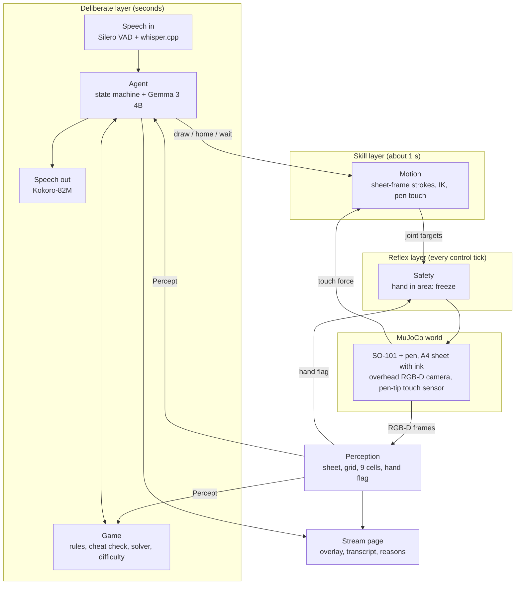

# Buddy: architecture and tech stack

*Working title. Agentverse 2026, Robotics track. Planning document, 7 November 2026.*

## What it does

Buddy is a robot arm that plays pen-and-paper games with older adults. The player says "Buddy, let's play a game?". The arm answers, offers tic-tac-toe, draws the grid on a blank A4 sheet while it explains the rules, then plays: it reads the player's marks with its camera and draws its own. Everything runs in MuJoCo on one laptop, with no network.

## Design rules

1. **Decisions come from perception.** Every move is computed from the latest camera reading of the sheet, not from memory. Memory is used only to notice differences: a mark out of turn, a sheet that moved.
2. **Three layers.** A reflex layer (safety) runs every control tick and never waits for anything else. A skill layer turns strokes into arm motion. A deliberate layer runs the game and the conversation.
3. **The language model does language only.** It turns speech into a structured intent and turns situations into spoken lines. It never chooses moves, positions or arm motions.
4. **When unsure, ask.** A low-confidence mark, a sheet out of reach or a failed line check leads to a question or a retry, never a guess.
5. **Everything on the device.** All models run locally on the laptop.

## System diagram



The whole system is one Python process. Modules talk through queues and "latest value" objects, which costs far less integration time than separate processes in a 12 to 20 hour build.

## Modules

| Module | Owner | Input | Output |
|---|---|---|---|
| `sim` | Arm | joint targets | RGB-D frames, touch force, joint angles; ink on the sheet where the pen touches; hooks to move the sheet, insert a hand, add a human mark |
| `motion` | Arm | strokes in sheet coordinates | IK paths, pen-down by touch, reach and clearance checks; stops on the safety flag |
| `perception` | Vision | RGB-D frames | a `Percept`: sheet pose, grid, 9 cell states with confidence, hand flag, overlay image |
| `game` | Brain | `Percept`, previous state | legality and cheat check, whose turn, winner, the robot's move (minimax with adaptive difficulty) |
| `agent` | Brain | intents, `Percept`, game events | the state machine, Gemma calls, motion commands, lines to say |
| `voice` | Voice and stage | microphone audio, `Say` events | transcripts; Kokoro speech |
| `ui` | Voice and stage | `Percept`, agent events, frames | stream page: camera view with overlay, transcript, current state, the reason for each move; scene-change buttons |

## Data contracts

Agreed in the first hour, in one shared `contracts.py`, so all four people code against the same shapes from the start.

```python
@dataclass
class SheetPose:            # A4 sheet, robot base frame
    x: float                # sheet centre, metres
    y: float
    yaw: float              # radians
    confidence: float

@dataclass
class CellState:
    mark: Literal["empty", "X", "O", "unclear"]
    confidence: float

@dataclass
class Percept:
    t: float
    sheet: SheetPose | None
    grid_found: bool
    cells: list[CellState]  # 9 cells, row by row
    hand_in_area: bool
    overlay: np.ndarray     # image for the stream page

@dataclass
class Stroke:               # one pen-down segment
    points_mm: list[tuple[float, float]]   # sheet frame

@dataclass
class Intent:               # Gemma output, JSON schema
    kind: Literal["play", "choose_game", "move",
                  "explain_rules", "repeat", "yes",
                  "no", "stop", "chat"]
    cell: int | None
    text: str

@dataclass
class Say:
    text: str
    priority: Literal["normal", "urgent"]
```

**Frames.** Robot base frame in metres: x forward, y to the robot's left, z up, z = 0 on the table. Sheet frame in millimetres from the sheet centre, x along the long edge.

## Sensors

| Sensor | Detects | Drives |
|---|---|---|
| Overhead RGB camera, 640x480, about 10 Hz | sheet pose, grid, marks | which move, where to draw, cheat detection |
| The same camera, depth | anything rising above the sheet | freeze when a hand enters the drawing area |
| Pen-tip touch sensor | pen contact and pressure | paper height, light pressure, skipped strokes |
| Microphone (the laptop's, real) | the player's voice | the conversation |

No LiDAR or IMU: a depth camera covers a tabletop, and the arm is fixed in place.

## Drawing on a blank A4 sheet

Reach measured on the calibrated SO-101 twin, pen held in the gripper, jaws within 5 to 10 degrees of vertical:

| Pen past the fingertips | Drawable distance from the shoulder axis | Largest square grid (1 cm margin) |
|---|---|---|
| 2 cm | 7 to 29 cm | 17 to 19 cm |
| 4 cm | 9.5 to 28.5 cm | 13.5 to 15.5 cm |
| 6 cm | 12 to 27 cm | 8 to 12 cm |

Plan: pen at most 3 to 4 cm past the fingertips, grid 12 to 15 cm (cells of 4 to 5 cm, easy to read), sheet in landscape, centred about 21 cm in front of the base.

**Setup sequence.** The setup is a perception-driven behaviour, not a fixed drawing:

1. Find the sheet: a white rectangle with the A4 ratio (1 : 1.41), giving its position and rotation.
2. Check reach. If the grid would not fit, ask the player to slide the sheet closer.
3. Plan the grid in the sheet frame, so it follows the sheet's rotation.
4. Touch down to find the paper height, then draw the four lines.
5. Check the lines with the camera. Redraw a broken line once, then report.

**Ink in MuJoCo.** MuJoCo has no ink. The sim paints into the sheet's texture where the pen touches it and re-uploads the texture, so ink moves with the sheet when someone slides it. Fallback: a pool of thin ink-dot geoms attached to the sheet body. This is the first thing to test.

## Conversation and game flow

States: IDLE (listening for "Buddy") → GREET → CHOOSE_GAME → SETUP (draws the grid while explaining the rules) → PLAYER_TURN ↔ ROBOT_TURN → GAME_OVER → GREET or IDLE.

Events that can interrupt any state:

| Event | Response |
|---|---|
| Hand in the drawing area | freeze at once (reflex layer), say why, resume when clear |
| Sheet moved | stop drawing, find the sheet and grid again, continue in the new position |
| Unclear mark | ask the player to confirm what they drew |
| Two new marks, or a mark during the robot's turn | point it out kindly and ask what they meant |
| Sheet out of reach | ask the player to move it closer |

**Adaptive difficulty.** The solver plays perfectly at full strength and plays a random legal move with probability p otherwise. p goes up after the robot wins and down after the player wins, so games stay close and fun.

**Speaking to older players.** Short sentences, a slightly slower voice, rules repeated on request, no time pressure.

## Tech stack

| Part | Choice | Licence | Notes |
|---|---|---|---|
| Simulator | MuJoCo 3.x | Apache 2.0 | no GPU needed |
| Robot model | SO-101 MJCF (SO-ARM100 project) with our calibrated twin and IK | Apache 2.0 for the model (to verify) | damped least-squares IK |
| Perception | OpenCV, NumPy | Apache 2.0, BSD | classical vision, no training |
| Game | own minimax for tic-tac-toe | ours | exact and instant |
| Dialogue | Gemma 3 4B via Ollama, JSON-schema output | Gemma terms of use | drop-in alternative: Qwen3 4B (Apache 2.0) |
| Unclear marks | the same Gemma 3 4B with image input | Gemma terms of use | only when confidence is low |
| Speech detection | Silero VAD | MIT | |
| Speech to text | whisper.cpp, `small.en` | MIT | already installed |
| Text to speech | Kokoro-82M | Apache 2.0 | sentence by sentence, adjustable speed, British voices |
| Stream page | local web server, MJPEG and WebSocket | | camera with overlay, transcript, reasons |
| Language | Python 3.12 | | one process, threads and queues |
| Hardware | MacBook Air M4, 16 GB | | offline |

## Latency budget

Targets, to be measured on the M4 with everything running at once:

| Step | Target |
|---|---|
| Perception, one frame | under 50 ms |
| Hand seen to arm frozen | under 100 ms |
| Whisper, one sentence | 0.5 to 1 s |
| Gemma, first token | 0.3 to 0.5 s |
| Kokoro, first sentence audible | about 0.3 s |
| Draw one X / the full grid | about 4 s / 15 to 20 s |

## Safety

**Critical failure mode:** the arm moving while a hand is on the sheet. The reflex layer reads the depth-based hand flag every control tick and holds the arm in place, independent of the language model and the game.

Other limits: reach and table-clearance checks on every path, light pen pressure from the touch sensor, slow speeds near the sheet.

## Team and milestones

| Role | Owns |
|---|---|
| Arm | `sim`, ink, `motion` |
| Vision | `perception`, overlay |
| Brain | `game`, `agent`, Gemma |
| Voice and stage | `voice`, `ui`, pitch material |

| By hour | Done when |
|---|---|
| 1 | contracts agreed; scene with sheet, pen, camera and touch sensor; a scripted line of ink visible on the stream page |
| 3 | the arm draws the grid and an X in a chosen cell |
| 5 | perception reads boards with confidence |
| 7 | a full typed game, start to finish |
| 9 | scene changes handled live: sheet moved, hand in area, cheat, unclear mark |
| 11 | voice in and out |
| After | polish, pitch, technical summary |

## Risks

| Risk | Plan |
|---|---|
| Ink painting does not work in MuJoCo | ink-dot geoms on the sheet body |
| Gemma too slow with the sim running | smaller model or shorter prompts; the arm never waits on it |
| Noisy venue breaks speech input | push-to-talk button and typed fallback |
| The pen drags the sheet | sheet friction in the sim; sliding the sheet becomes a planned scene change |
| Shaky strokes misread | ask the player; Gemma image check as backup |
